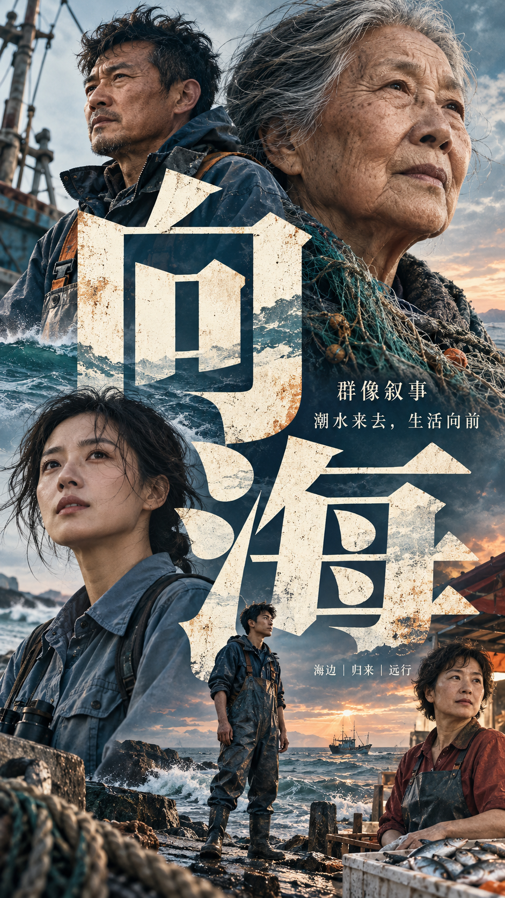
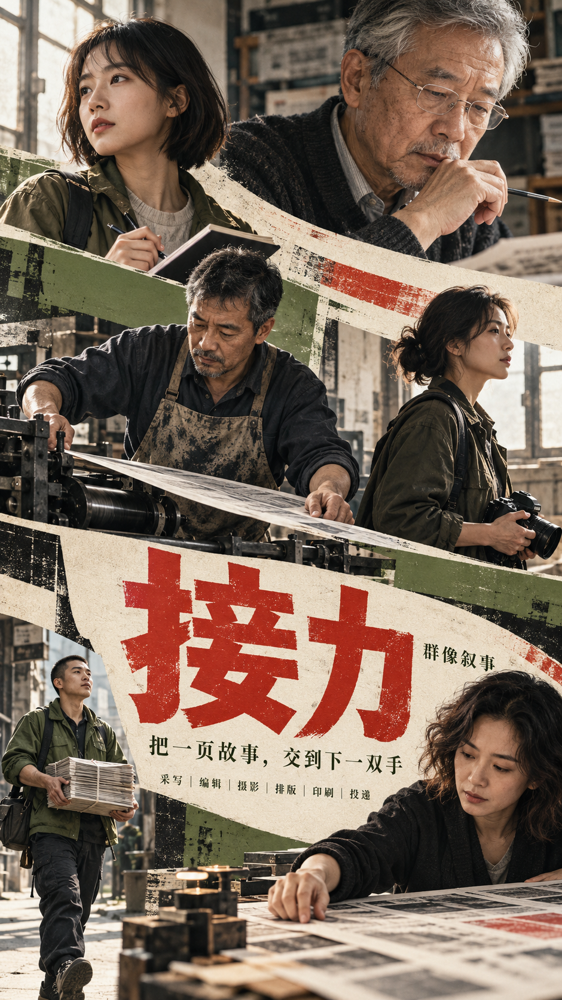
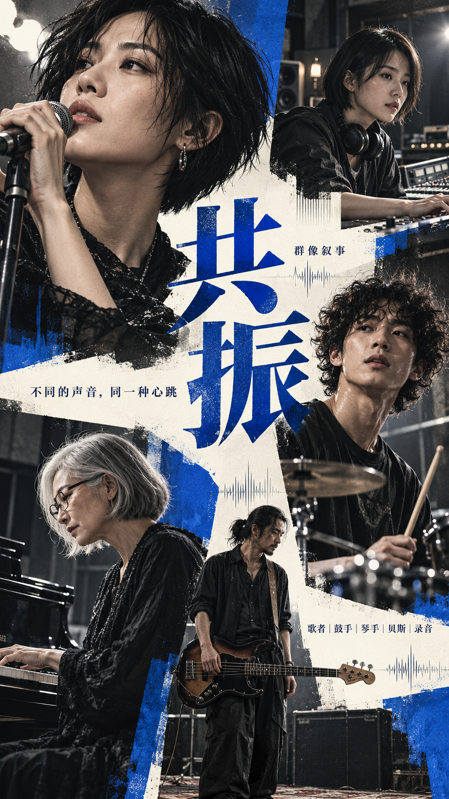
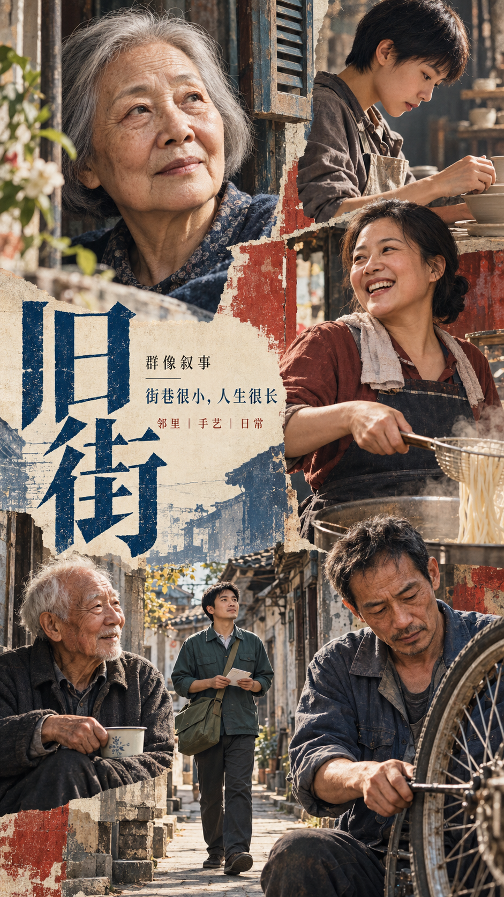
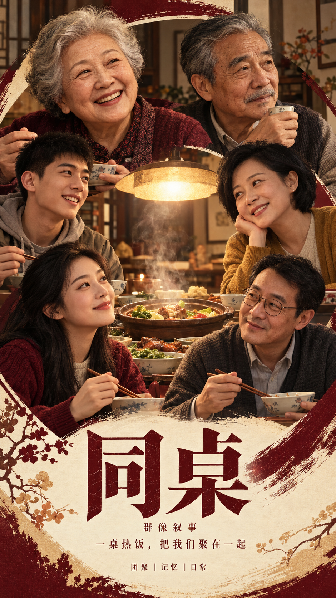
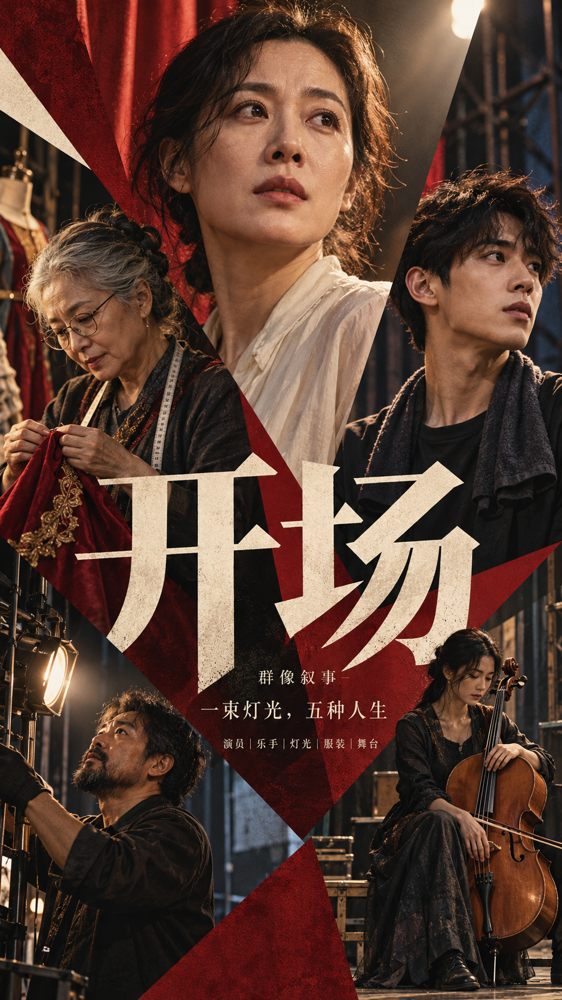
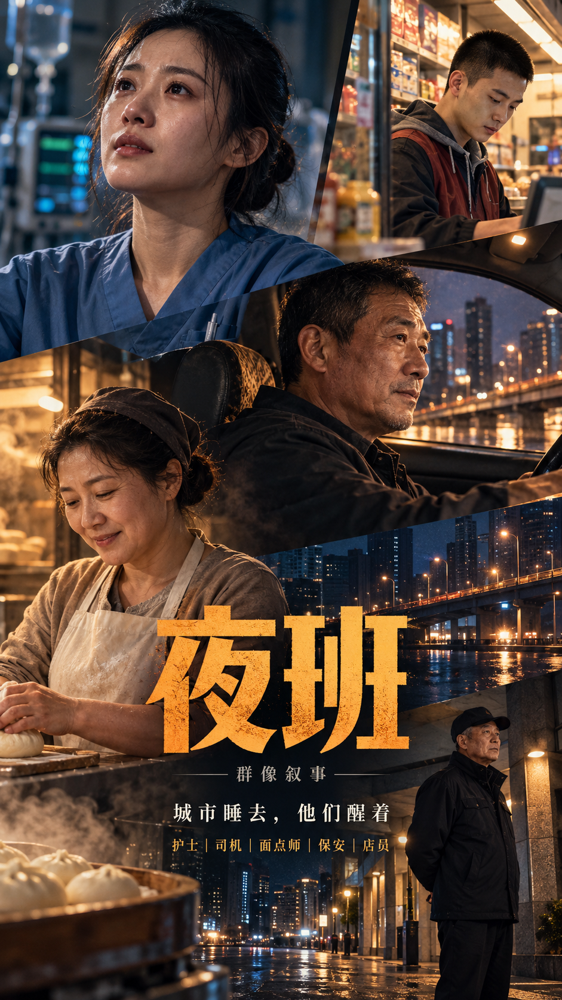
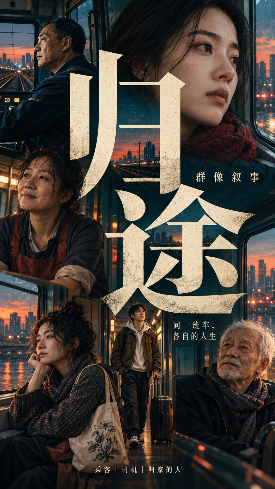

# 多人物叙事编辑海报 Skill / Ensemble Editorial Poster Skill

## 作品展示 · Gallery

以下海报均由本 Skill 生成。

| | | | |
|---|---|---|---|
|  |  |  |  |
|  |  |  |  |

## 它能做什么
- 自动设计人物群像：年龄、身份、性格、姿态与关系各不相同
- 六种主图形系统：超大字体 / 分层色带 / 几何切割 / 环形构图 / 自由拼贴 / 不规则肖像网格
- 大中小人物与多种裁切，人物与字体、图形叠压融合
- 英文标题与有意义的次要文字（署名、宣传语），不用填充文字
- 只给主题也能用

## 安装
**作为 Agent Skill（Claude Code / Cursor / Codex 等）**：

```bash
git clone https://github.com/ericchan916/ensemble-editorial-poster-skill.git
cp -r ensemble-editorial-poster-skill ~/.claude/skills/ensemble-editorial-poster
# 或 ~/.cursor/skills/、~/.codex/skills/ 等
```

**在 ChatGPT / 其他图像模型中使用**：复制 [`prompt.md`](prompt.md) 里的完整英文提示词，填入 THEME 等字段即可。

## 使用示例
```
THEME: a neighborhood choir rehearsing for its final concert
VISUAL STRUCTURE: circular composition
TITLE: "ONE MORE SONG"
```
或只写：`THEME: a night-shift diner where strangers become family`

更多示例见 [`examples/themes.md`](examples/themes.md)。

## 图形系统
| 结构 | 特点 |
|---|---|
| oversized typography | 超大标题字与人物穿插 |
| layered bands | 横向/斜向色带分层叙事 |
| geometric cuts | 几何块面切割画面与人物 |
| circular composition | 环形或同心圆组织人物 |
| freeform collage | 自由拼贴、剪切与叠压 |
| irregular portrait grid | 大小不一、错位的肖像网格 |

## English
**Ensemble Editorial Poster** creates one 9:16 high-end multi-character poster about a theme: 4–7 distinct characters bound by a believable story, one strong graphic system, varied figure scales and crops, and bold English editorial typography. Copy the folder into your agent's skills directory, or paste `prompt.md` into ChatGPT or any image model.

## License
MIT © 2026 Joy Robinson — 见 [LICENSE](LICENSE)。生成图片的使用请同时遵守你所用图像模型的服务条款。
